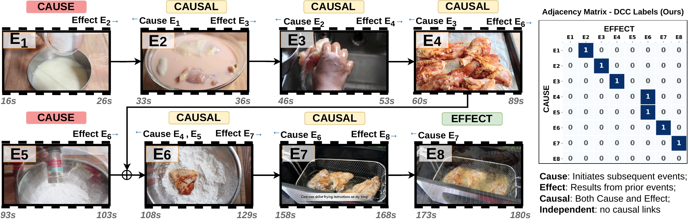

<div align="center">

# Causal-VLM: Dense Causal Captioning in Videos

**NeurIPS 2026**

Asmar Nadeem¹ · Mahrukh Awan¹ · Muhammad Awais¹ · Robert Dawes² · Adrian Hilton¹ · Armin Mustafa¹

¹ CVSSP, University of Surrey &nbsp; · &nbsp; ² BBC Research and Development

**[Project page](https://causalvlm.github.io/) · [Paper](assets/Causal-VLM.pdf) · [Model weights](https://huggingface.co/causalvlm/CausalVLM) · [DCC dataset](https://huggingface.co/datasets/causalvlm/DCC)**

</div>

Causal-VLM connects dense video captions with a graph of observed prerequisite
relationships between events. This repository contains **Causal-VLM and DCC code**.



## Contents

- [Installation](#installation)
- [Inference](#inference)
- [Training](#training)
- [DCC benchmark generation](#dcc-benchmark-generation)
- [Repository structure](#repository-structure)
- [Citation](#citation)

## Installation

Use Linux, Python 3.11, and a CUDA-capable GPU.

```bash
git clone https://github.com/causalvlm/CausalVLM.git
cd CausalVLM

python3.11 -m venv .venv
source .venv/bin/activate
python -m pip install --upgrade pip
python -m pip install torch==2.7.1 torchvision==0.22.1 --index-url https://download.pytorch.org/whl/cu126
python -m pip install -r causal_vlm/requirements.txt
```

The PyTorch command uses CUDA 12.6 wheels; use the matching build from
[PyTorch](https://pytorch.org/get-started/previous-versions/#v271) if your system
requires another CUDA version. Run the commands below from the repository root.
DCC generation has [additional dependencies](dcc_benchmark/README.md#setup).

## Inference

### Published model

Accept the access terms on the [model page](https://huggingface.co/causalvlm/CausalVLM),
then authenticate and run inference on your video:

```bash
hf auth login

python -m causal_vlm.predict_published \
  --checkpoint causalvlm/CausalVLM \
  --video /path/to/video.mp4 \
  --output outputs/predictions.json
```

The output contains event captions, onset timestamps, and causal relationships.
See the [inference guide](docs/inference.md) for more options.

### Checkpoints trained with this repository

Use `python -m causal_vlm.predict` for checkpoints saved by this repository.
See [frame preparation and usage](docs/inference.md#checkpoints-from-this-training-code).

## Training

Download the [DCC labels](https://huggingface.co/datasets/causalvlm/DCC), obtain the
corresponding source videos, and follow the [data preparation guide](docs/data.md)
to create the training and validation inputs under `data/`.

Stage 1 trains the captioner with a newly
initialized projector. Stage 2 restores that model, trains the causal head, and
then jointly trains both components.

Run inside a four-GPU allocation:

```bash
python -m torch.distributed.run --standalone --nproc_per_node=4 \
  --module causal_vlm.train_stage1 \
  --config causal_vlm/configs/stage1.yaml \
  --data data --save-dir checkpoints/stage1

python -m torch.distributed.run --standalone --nproc_per_node=4 \
  --module causal_vlm.train_stage2 \
  --config causal_vlm/configs/stage2.yaml \
  --data data --stage1-ckpt checkpoints/stage1/last_model.pt \
  --save-dir checkpoints/stage2
```

See the [training guide](docs/training.md) for configuration and data requirements.

## DCC benchmark generation

Download the ActivityNet and YouCook2 annotations from
**[Hugging Face: causalvlm/DCC](https://huggingface.co/datasets/causalvlm/DCC)**.
To generate annotations, follow the [DCC guide](dcc_benchmark/README.md).

Model weights, labels, and source videos retain the terms on their respective
resource pages; see [data and downloads](docs/data.md#published-resources).

## Repository structure

```text
CausalVLM/
├── causal_vlm/                  Causal-VLM implementation
│   ├── configs/                 Stage 1 and Stage 2 configurations
│   ├── src/                     Models, data loading, losses, and training utilities
│   ├── prepare_video.py         Frame and timestamp preparation
│   ├── train_stage1.py          Captioning curriculum
│   ├── train_stage2.py          Causal-head and joint training
│   ├── predict.py               Inference from training checkpoints
│   └── predict_published.py     Inference from published weights
├── dcc_benchmark/               DCC implementation
├── docs/                       Usage guides
├── assets/                     Paper and overview figure
├── CITATION.cff                Citation metadata
└── requirements.txt            Combined model and DCC dependencies
```

## Citation

```bibtex
@inproceedings{nadeem2026causalvlm,
  title     = {Causal-VLM: Dense Causal Captioning in Videos},
  author    = {Nadeem, Asmar and Awan, Mahrukh and Awais, Muhammad
               and Dawes, Robert and Hilton, Adrian and Mustafa, Armin},
  booktitle = {Advances in Neural Information Processing Systems},
  year      = {2026}
}
```

## Acknowledgements

This work builds on [Perception Encoder and Perception-LM](https://github.com/facebookresearch/perception_models),
[Llama](https://github.com/meta-llama/llama-models),
[DINOv2](https://github.com/facebookresearch/dinov2),
[InternVL](https://github.com/OpenGVLab/InternVL), and
[EMScore](https://github.com/ShiYaya/EMScore).
